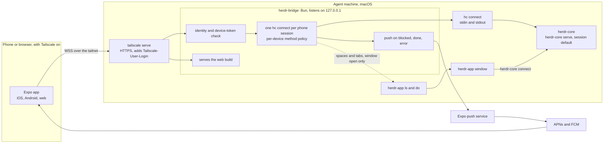
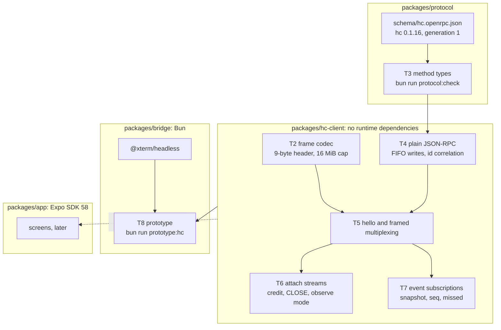

# Architecture

How the pieces fit, as planned on 2026-11-02. The decisions behind it are in [research.md](research.md#decisions), and the task order comes from the unshit plan for `hc-client`.

## System

## Packages and the hc-client layers

`bun run prototype:hc` runs the whole stack once against a scratch core. [prototype.md](prototype.md) covers its isolation, deadlines, interruption and cleanup.

## Dependencies

| Package           | Used by              | Version    | Why                                                                                                                     |
| ----------------- | -------------------- | ---------- | ----------------------------------------------------------------------------------------------------------------------- |
| none              | `packages/hc-client` |            | Runs in Bun and in Hermes. Typed arrays, `DataView` and a small UTF-8 helper replace `node:buffer` and encoding globals |
| `@xterm/headless` | `packages/bridge`    | 6.0.0, MIT | Turns attach-stream bytes into screen text in the prototype                                                             |
| Bun built-ins     | `packages/bridge`    | Bun 1.4.4  | `Bun.spawn` for `hc connect`, `bun test`                                                                                |
| `typescript`      | workspace            | ~6.0.3     | Typecheck, same version as the Expo template                                                                            |
| `@biomejs/biome`  | workspace            | 2.6.4      | Lint and format                                                                                                         |
| `@types/bun`      | workspace            | ^1.4.4     | Types for Bun APIs and `bun:test`                                                                                       |
| Expo SDK 58       | `packages/app`       | 58         | Already in the scaffold; this milestone doesn't touch it                                                                |

Later milestones add `Bun.serve` for the bridge's WebSocket server, a native terminal renderer in the app (Paseo's `@xterm/headless` plus native grid is the reference), `expo-notifications` for push and `expo-camera` for QR pairing.
