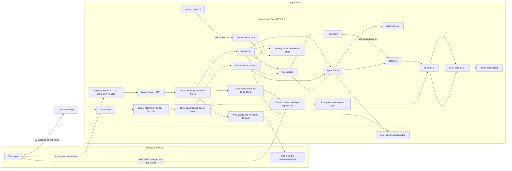

# Architecture

This page describes the integrated v1 app and bridge. The transport and security decisions are in [research.md](research.md#decisions). The herdr-core client prototype and its scratch-session rules are in [prototype.md](prototype.md).

## System

Tailscale Serve forwards direct-route requests to the loopback bridge and supplies
`Tailscale-User-Login`. The direct listener checks that identity before handling API, static-file or
WebSocket requests. Pairing uses the identity header and a one-time code. Other API calls and
WebSocket sessions also need a paired device token.

`cloudflared` forwards the secure route to the second loopback listener. That listener trusts no
headers and accepts only `GET /ws`; all API requests travel inside the Noise channel. The secure
channel and direct listener both dispatch task routes. The secure listener passes the full dispatch
context to `dispatchApi`, including `taskRoutes`. The app pins
the bridge's public key before it sends a token or pairing code. The secure listener returns `404`
for every other path, including `/api`. The two listeners share pairing, the role policy and the
herdr-core session code. The secure listener never changes the direct route.

The direct listener serves the app's web export from `--web`; missing paths fall back to `index.html`
for app routes. The secure listener does not serve the web build. Browser secure-route checks use the
local Expo development server. See [bridge setup](bridge.md) for the build, Serve and pairing
commands.

## Packages

| Package              | Boundary                                                                                                                                                                                                                   |
| -------------------- | -------------------------------------------------------------------------------------------------------------------------------------------------------------------------------------------------------------------------- |
| `packages/protocol`  | Pinned `schema/hc.openrpc.json` and wire types shared by the bridge and app. `bun run protocol:check` checks generated types.                                                                                              |
| `packages/hc-client` | Runtime-neutral JSON-RPC, line and frame codecs, attach streams and events. It has no runtime dependencies and imports no Node built-ins.                                                                                  |
| `packages/bridge`    | Bun CLI, direct and secure loopback listeners, Noise channel, Unix admin socket, pairing and device storage, process sessions, gate, `AgentStarter`, `AllowedRoots`, `callCore`, herdr-app actions and static web serving. |
| `packages/app`       | Expo Router client for iOS, Android and web. Expo CLI and Metro run with Node 24.                                                                                                                                          |

The bridge's `hc connect` child communicates with herdr-core over stdio. The child receives only the configured environment, including an optional `HC_SESSION`. `Gate` checks channel-zero JSON-RPC calls against the paired device's role and forwards allowed core bytes unchanged. Nonzero attachment channels pass through. See [bridge details](bridge.md) for the full policy and API.

`AgentStarter` handles the control-only agent catalog and starts requested by `TaskRoutes`. It checks the selected program or template and folder, then starts the agent in the open Herdr window or in herdr-core. `AllowedRoots` resolves the home and configured roots by real path on first use, with a five-second deadline per root. `callCore` makes short-lived `hc connect` calls for `templates.list`, `terminal.run`, and task-document reads and writes.

## App layers

| Layer    | Location                                                | Responsibility                                                                                                                                                                                                                  |
| -------- | ------------------------------------------------------- | ------------------------------------------------------------------------------------------------------------------------------------------------------------------------------------------------------------------------------- |
| Network  | `packages/app/src/net/`                                 | Pairing API, link parsing, WebSocket adapter and `ConnectionManager`. The manager authenticates, starts hc-client in framed mode, subscribes to events, loads the `herdr-app` document and reconnects after transport failures. |
| Stores   | `packages/app/src/store/`                               | Persisted settings, paired machine records and seen turns, plus the in-memory core snapshot. Native settings use SQLite key-value storage and SecureStore secrets. Web settings and secrets use `localStorage`.                 |
| Models   | `packages/app/src/model/`                               | Pure terminal, status, prompt, agent, space, address and seen-state derivation. Screens render these results.                                                                                                                   |
| Terminal | `packages/app/src/terminal/`                            | `@xterm/headless` model, styled screen snapshots, ANSI theme palettes and the native text-grid renderer. Attach credit returns after the renderer writes output.                                                                |
| Screens  | `packages/app/src/screens/` and `packages/app/src/app/` | Home, Project, project terminals, agent terminal, Settings and pairing routes. View functions derive presentation; route components connect stores, actions and UI.                                                             |
| UI       | `packages/app/src/ui/`                                  | Uniwind themes, fonts, safe-area handling, Image and FlashList wrappers, shared text variants and controls.                                                                                                                     |

The settings store selects `system`, `graphite` or `paper` before the first route renders. The root layout holds the splash screen until boot hydration and font loading finish. A failed font load offers a retry state.

## Data flow by screen

1. **Home.** `ConnectionManager` feeds core snapshots and events into the core store. The phone reads `herdr-mobile.tasks` with `doc.get` and applies its `doc` events. `deriveTasks` combines task records, local terminals, the `herdr-app` layout and status to produce task rows and counts. `deriveHomeView` filters title, project and program, builds Needs you, Running and Done counts, and keeps local projects in Herdr order. Home also selects paired Macs, routes to projects, and shows the connection banner.
2. **Project.** The screen selects task rows for a Herdr space and orders them by creation time. `deriveProjectView` chooses whether checked rows appear and which controls are available for the current role and connection. `check-off.ts` builds the active-task sheet actions and sends `terminal.kill` before checking when Stop is chosen. Done and stopped tasks check immediately. Done summaries lazily read terminal screen text through `ScreenText` and `summarize`.
3. **Project terminals.** `deriveSpaces` uses the layout document and terminal labels to build the project's tabs. `TabPill` opens the first terminal in each tab. Plain terminals and shells are reached from this project route.
4. **Agent terminal.** The screen attaches with `observe: true` at the Mac terminal's size. `TerminalModel` parses output and creates styled rows for `TerminalPane`. A size event updates the model. Keys and composer text call `terminal.keys` and `terminal.send`. Take over confirms before it reattaches without observe at the pane size. Interrupt and end-terminal actions also require confirmation.
5. **Needs-you prompt.** The Claude Code and Codex recognizers read the terminal status and screen snapshot. A recognized prompt adds answer choices. A watch-role device sees the prompt without answer controls. An unrecognized prompt leaves the composer available for direct input.
6. **Pairing.** The app reads a v1 or v2 `#pair=` fragment, pasted link or typed URL and code. A v2 offer with a secure URL and key pairs over the Noise channel first. The app sends the one-time code only after it verifies the pinned bridge key, saves the returned token through `Secrets`, adds the routes and makes the Mac active. `ConnectionManager` then races the stored routes. A matching known key in a fresh link updates only the secure route; it does not change the direct route or redeem the code. Pairing returns to Home.
7. **Settings.** Settings is pushed from Home's `⋯` menu. Theme and notification preferences persist in the settings store. Notification switches do not send push notifications. The Machines section revokes a device through `/api/devices/self`, then removes local machine data even if the bridge cannot be reached. About shows app and protocol versions and explains web storage.
8. **Task writes.** The Project composer sends `POST /api/tasks` through the direct listener or the secure channel. Both dispatch paths call `TaskRoutes`, which starts the agent through `AgentStarter` and writes the accepted task record with `doc.set`. Check-off, linking, unchecking and clearing use the same routes and document. The phone receives document updates through `doc` events.

## Build and verification boundaries

Run `bun run build:web` from the repository root to export the app into `packages/app/dist`. `herdr-bridge serve --owner <login> --web packages/app/dist` serves that directory through the same identity-gated handler as the API and WebSocket routes. The handler applies COOP and COEP headers to static responses.

The web export checks bundling, and bridge tests use fake filesystems and handlers without opening a port. Use the [smoke checklist](smoke-checklist.md) for the isolated secure-route, native-device and browser checks.

Push delivery is the remaining product feature. The notification settings only persist preferences. U15 waits for push credentials.
