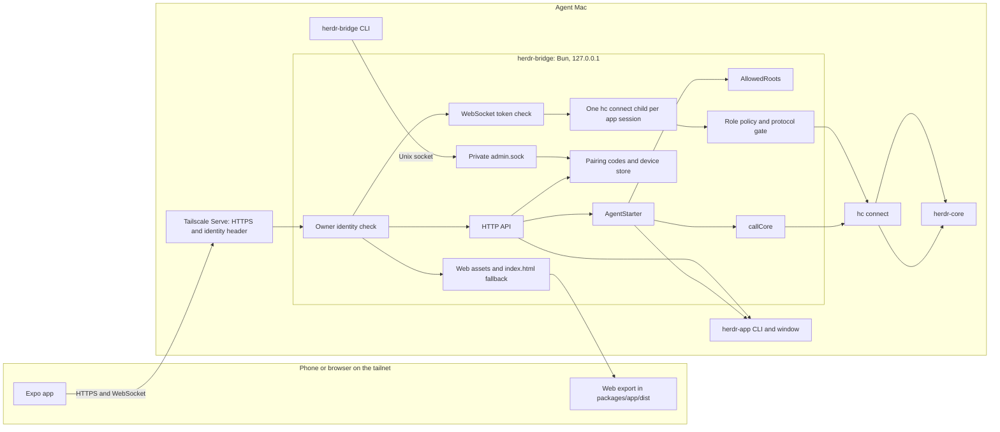

# Architecture

This page describes the integrated v1 app and bridge. The transport and security decisions are in [research.md](research.md#decisions). The herdr-core client prototype and its scratch-session rules are in [prototype.md](prototype.md).

## System

Tailscale Serve forwards tailnet requests to the loopback bridge and supplies `Tailscale-User-Login`. The bridge checks that identity before handling API, static-file or WebSocket requests. Pairing uses the identity header and a one-time code. Other API calls and WebSocket sessions also need a paired device token.

The app's web export uses the same hostname and bridge as the native app. The bridge serves files from `--web`; missing paths fall back to `index.html` for app routes. See [bridge setup](bridge.md) for the build, Serve and pairing commands.

## Packages

| Package              | Boundary                                                                                                                                                                                                  |
| -------------------- | --------------------------------------------------------------------------------------------------------------------------------------------------------------------------------------------------------- |
| `packages/protocol`  | Pinned `schema/hc.openrpc.json` and wire types shared by the bridge and app. `bun run protocol:check` checks generated types.                                                                             |
| `packages/hc-client` | Runtime-neutral JSON-RPC, line and frame codecs, attach streams and events. It has no runtime dependencies and imports no Node built-ins.                                                                 |
| `packages/bridge`    | Bun CLI, loopback HTTP and WebSocket server, Unix admin socket, pairing and device storage, process sessions, gate, `AgentStarter`, `AllowedRoots`, `callCore`, herdr-app actions and static web serving. |
| `packages/app`       | Expo Router client for iOS, Android and web. Expo CLI and Metro run with Node 24.                                                                                                                         |

The bridge's `hc connect` child communicates with herdr-core over stdio. The child receives only the configured environment, including an optional `HC_SESSION`. `Gate` checks channel-zero JSON-RPC calls against the paired device's role and forwards allowed core bytes unchanged. Nonzero attachment channels pass through. See [bridge details](bridge.md) for the full policy and API.

`AgentStarter` handles the control-only agent catalog and start routes. It validates the selected program or template and folder, then places a start in the open Herdr window or in herdr-core. `AllowedRoots` resolves the home and configured roots by real path on first use, with a five-second deadline per root. `callCore` makes short-lived `hc connect` calls for `templates.list` and, when the window is closed, `terminal.run`.

## App layers

| Layer    | Location                                                | Responsibility                                                                                                                                                                                                                  |
| -------- | ------------------------------------------------------- | ------------------------------------------------------------------------------------------------------------------------------------------------------------------------------------------------------------------------------- |
| Network  | `packages/app/src/net/`                                 | Pairing API, link parsing, WebSocket adapter and `ConnectionManager`. The manager authenticates, starts hc-client in framed mode, subscribes to events, loads the `herdr-app` document and reconnects after transport failures. |
| Stores   | `packages/app/src/store/`                               | Persisted settings, paired machine records and seen turns, plus the in-memory core snapshot. Native settings use SQLite key-value storage and SecureStore secrets. Web settings and secrets use `localStorage`.                 |
| Models   | `packages/app/src/model/`                               | Pure terminal, status, prompt, agent, space, address and seen-state derivation. Screens render these results.                                                                                                                   |
| Terminal | `packages/app/src/terminal/`                            | `@xterm/headless` model, styled screen snapshots, ANSI theme palettes and the native text-grid renderer. Attach credit returns after the renderer writes output.                                                                |
| Screens  | `packages/app/src/screens/` and `packages/app/src/app/` | Agents, agent terminal, spaces, settings and pairing routes. Controllers hold interaction state; route components connect them to stores and UI.                                                                                |
| UI       | `packages/app/src/ui/`                                  | Uniwind themes, fonts, safe-area handling, Image and FlashList wrappers, shared text variants and controls.                                                                                                                     |

The settings store selects `system`, `graphite` or `paper` before the first route renders. The root layout holds the splash screen until boot hydration and font loading finish. A failed font load offers a retry state.

## Data flow by screen

1. **Agents.** `ConnectionManager` feeds core snapshots and events into the core store. `deriveAgents` combines terminals, the `herdr-app` layout, seen turns and receipt time. It chooses titles and subtitles, marks urgency and groups agents into Needs you, Done, Working and Idle. The Agents screen renders the rows and machine connection state.
2. **Agent terminal.** The screen attaches with `observe: true` at the Mac terminal's size. `TerminalModel` parses output and creates styled rows for `TerminalPane`. A size event updates the model. Keys and composer text call `terminal.keys` and `terminal.send`. Take over confirms before it reattaches without observe at the pane size. Interrupt and end-terminal actions also require confirmation.
3. **Needs-you prompt.** The Claude Code and Codex recognizers read the terminal status and screen snapshot. A recognized prompt adds answer choices. A watch-role device sees the prompt without answer controls. An unrecognized prompt leaves the composer available for direct input.
4. **Spaces.** `deriveSpaces` combines the `herdr-app` layout document with core terminals. The screen keeps document and tab order, uses fallback labels when the document is missing, and shows connection state by machine. New space and tab actions call the bridge's `/api/app/do` route, which invokes the configured `herdr-app` executable.
5. **Agents by space.** With `agents.sort` set to `space`, the Agents screen groups the same derived rows by document order and tab order.
6. **Pairing.** The app reads a `#pair=` fragment, pasted link or typed URL and code. It sends the one-time code to `/api/pair`, saves the returned token through `Secrets`, adds the public machine record and makes it active. `ConnectionManager` then opens the bridge WebSocket. The connection line reports the paired device name and connection state.
7. **Settings.** Theme and notification preferences persist in the settings store. Notification switches do not send push notifications. The Machines section revokes a device through `/api/devices/self`, then removes local machine data even if the bridge cannot be reached. About shows app and protocol versions and explains web storage.
8. **Start agent.** The Start screen loads `/api/agents/catalog` and submits `/api/agents/start`. `AgentStarter` checks the request and chooses `herdr-app do` when the window is open or `callCore` and `terminal.run` when it is closed. `AllowedRoots` checks the folder against real paths for home and configured roots. A first message for a built-in requires the window to be open; a template can use herdr-core's first-message path. On success, the app opens the agent when the reply has an address, or Spaces otherwise.

## Build and verification boundaries

Run `bun run build:web` from the repository root to export the app into `packages/app/dist`. `herdr-bridge serve --owner <login> --web packages/app/dist` serves that directory through the same identity-gated handler as the API and WebSocket routes. The handler applies COOP and COEP headers to static responses.

The first simulator, physical-device and browser runs are still pending. The web export checks bundling, and bridge tests use fake filesystems and handlers without opening a port. Use the [smoke checklist](smoke-checklist.md) for the native and browser checks.

Push delivery is the remaining product feature. The notification settings only persist preferences. U15 waits for push credentials.
