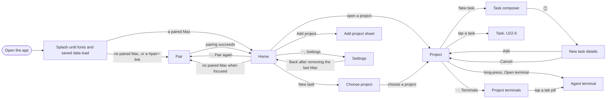

# Feature map

This page lists what a user can see and do in herdr mobile, in the phone and web app and on the Mac's bridge, with the code behind each feature. The tables describe `main`. Work in progress is under [In flight](#in-flight), and work that hasn't started is under [Planned](#planned).

Look a feature up here before you change it. Cite its ID, such as `TERM-5`, in issues, PRs and commit messages.

## Keeping it current

Update this page in the same commit as any change a user can see or do. That covers screens, controls, gestures, messages, role rules and bridge commands.

- Edit the feature's row, or add one. A new feature takes the next free number in its area. IDs never change, and a removed feature's ID is not reused.
- Add a line to the [change log](#change-log), newest first.
- Redraw the [navigation chart](#navigation) when a route, or a way from one screen to another, changes.
- List an open PR that changes a feature under [In flight](#in-flight), and move the change into the tables when it merges.

`bun test` runs [feature-map.test.ts](feature-map.test.ts). It fails when a code path or link here points at nothing, when an app route, screen folder or `herdr-bridge` command has no entry, or when an ID is duplicated or cited without a row.

Code paths start from the repository root, `packages/app/src/` or `packages/bridge/src/`. Tests sit next to their code as `*.test.ts`. UI text in code spans, like `Couldn’t load the app fonts.`, is copied from the code, so a search finds it. `<Mac>` and `<program>` stand for names the app fills in.

## Navigation

Smart tiles show Needs you, Running and Done counts. The list routes arrive in U22-7; the tiles have no navigation yet. Home's `New task` opens a project picker and focuses that project's composer. `Add project` opens its sheet. Back on the agent terminal returns to the screen that opened it.

## Roles

Pairing gives each device a role. `herdr-bridge pair` makes a control device and `herdr-bridge pair --watch` makes a watch device. The app hides what a watch device can't do. The bridge's gate rejects those calls anyway, using the method lists in `packages/protocol/src/policy.ts`.

| Feature                                       | Control                        | Watch                                      |
| --------------------------------------------- | ------------------------------ | ------------------------------------------ |
| Home, projects, task rows and terminal output | Yes                            | Yes                                        |
| Choose a paired Mac                           | Yes                            | Yes                                        |
| Check off or clear tasks                      | Yes, while connected           | No                                         |
| Add a task or project                         | Control devices show the entry | No                                         |
| Open a terminal or copy its address           | Yes                            | Yes                                        |
| Follow up or answer a recognized prompt       | Yes                            | No. The question shows without its choices |
| Take over, Interrupt, End terminal            | Yes                            | No. The More button is gone                |
| Settings                                      | Yes                            | Yes                                        |
| Start an agent or create an empty tab         | Control devices use `New task` | No. Watch devices cannot start an agent    |

## App launch

| ID       | User action                                                           | What the app does                                                                                                                                | Code                                                                              |
| -------- | --------------------------------------------------------------------- | ------------------------------------------------------------------------------------------------------------------------------------------------ | --------------------------------------------------------------------------------- |
| LAUNCH-1 | Opens the app                                                         | Keeps the splash up until saved settings, paired Macs, seen turns and the five font faces load. Applies the saved theme before the first screen. | `app/_layout.tsx`, `boot.tsx`, `store/lifecycle.ts`, `ui/fonts.ts`, `ui/theme.ts` |
| LAUNCH-2 | Opens the app and the fonts fail to load                              | Shows `Couldn’t load the app fonts.` with Retry.                                                                                                 | `app/_layout.tsx`                                                                 |
| LAUNCH-3 | Opens the app with no paired Mac, or opens a `#pair=` link on the web | Opens Pair. A paired device opens Home.                                                                                                          | `app/index.tsx`, `screens/pair/pair-fragment.ts`                                  |

## Pairing

Route `/pair`. Code in `screens/pair/`.

| ID     | User action                           | What the app does                                                                                                                                                                                                                                                        | Code                                                                                                                                               |
| ------ | ------------------------------------- | ------------------------------------------------------------------------------------------------------------------------------------------------------------------------------------------------------------------------------------------------------------------------ | -------------------------------------------------------------------------------------------------------------------------------------------------- |
| PAIR-1 | Opens Pair                            | Shows how to start the bridge and scan its code. Step 3 says `Keep Tailscale on, or set up the secure route.` The intro explains that either route can reach the bridge.                                                                                                 | `app/pair.tsx`, `screens/pair/PairScreen.tsx`, `screens/pair/PairingSteps.tsx`, `screens/pair/Snippet.tsx`, `screens/pair/snippet-controller.ts`   |
| PAIR-2 | Taps `Scan the code`                  | Opens the scanner as a sheet on iOS that a downward swipe closes, full screen on Android, and as a centered card on the web. Asks for camera access, then pairs on the first QR code read. With camera access off, it says `You can enter the address and code instead.` | `screens/pair/Scanner.tsx`, `screens/pair/scanner-controller.ts`                                                                                   |
| PAIR-3 | Taps `Type the address instead`       | Takes a bridge URL or full pairing link and the 8-character code. A typed URL without a key pairs over Tailscale. The hint says `Typing works over Tailscale. Without it, scan the code or paste the full link.`                                                         | `screens/pair/ManualEntry.tsx`, `screens/pair/pairing.ts`                                                                                          |
| PAIR-4 | Opens a pairing link in a browser     | Removes the v1 or v2 `#pair=` fragment from the address bar, opens Pair and pairs. Browsers don't send the fragment to the bridge.                                                                                                                                       | `screens/pair/pair-fragment.ts`, `net/pair-link.ts`                                                                                                |
| PAIR-5 | Pairs                                 | Keeps the token in SecureStore on native or browser storage on the web, makes the Mac active and connects. Returns to Home and says `Paired with <Mac>. Opening your tasks…`.                                                                                            | `screens/pair/PairScreen.tsx`, `screens/pair/pair-controller.ts`, `screens/pair/connection-line-state.ts`, `net/bridge-api.ts`, `store/secrets.ts` |
| PAIR-6 | Hits an error                         | Shows the cause in a banner, such as `That pairing code is invalid or has expired. Generate a new code on your Mac.`, with Retry when retrying can help.                                                                                                                 | `screens/pair/pairing.ts`, `screens/pair/pair-controller.ts`                                                                                       |
| PAIR-7 | Pairs from a link with a secure route | When a link has `s` and `k`, sends the code over the Noise channel first. If the channel fails before the code is redeemed, tries the direct route. Saves the token, routes and bridge key.                                                                              | `screens/pair/pairing.ts`, `screens/pair/pair-controller.ts`, `net/route-opener.ts`, `store/secrets.ts`                                            |
| PAIR-8 | Opens a fresh link for a known Mac    | When `k` matches a stored key, updates only that Mac's secure route from `s`, keeps its direct route and token, makes it active, and shows `Updated the address for <Mac>.` without redeeming the code.                                                                  | `screens/pair/pairing.ts`, `screens/pair/pair-controller.ts`, `store/machines.ts`                                                                  |

## Connection

The app holds one bridge connection, to the active Mac. Home and Project show its state in a banner. The agent terminal has its own, see `TERM-13`.

| ID     | User action                                | What the app does                                                                                                                                                                                                                                                              | Code                                                                                                                                                                                      |
| ------ | ------------------------------------------ | ------------------------------------------------------------------------------------------------------------------------------------------------------------------------------------------------------------------------------------------------------------------------------ | ----------------------------------------------------------------------------------------------------------------------------------------------------------------------------------------- |
| CONN-1 | Sends the app to the background, then back | Stops the connection in the background and starts it again in the foreground.                                                                                                                                                                                                  | `store/lifecycle.ts`                                                                                                                                                                      |
| CONN-2 | Picks another Mac                          | Closes the old connection and connects to the new Mac.                                                                                                                                                                                                                         | `store/lifecycle.ts`, `store/machines.ts`                                                                                                                                                 |
| CONN-3 | Loses the connection                       | Races the saved direct and secure routes. The first route to authenticate carries the core connection; other candidates close. Retries after 1, 2, 4 and 8 seconds, then every 15 seconds. 45 seconds without a message also counts as a lost connection.                      | `net/connection.ts`, `net/route-opener.ts`, `net/secure-socket.ts`, `net/channel-fetch.ts`, `screens/home/connectionPresentation.ts`                                                      |
| CONN-4 | Sees the connection stopped                | Shows `Can't reach your Mac. Check it's awake and online.` when a secure route exists, otherwise `Can't reach the bridge. Check that Tailscale is on.` Retry restarts the connection. Direct HTTP calls remain available while a route reconnects.                             | `net/connection.ts`, `net/bridge-calls.ts`, `screens/home/connectionPresentation.ts`, `screens/home/ConnectionBanner.tsx`, `screens/home/PairAgainBanner.tsx`, `ui/components/Banner.tsx` |
| CONN-5 | Uses a device the bridge no longer accepts | Shows `This device is no longer paired with <Mac>.` with `Pair again`, which opens Pair.                                                                                                                                                                                       | `net/connection.ts`, `screens/home/PairAgainBanner.tsx`                                                                                                                                   |
| CONN-6 | Connects through an available route        | Races the saved direct and Noise-protected secure routes. If one fails, the other can still authenticate; the winner carries the core connection and closes remaining candidates. The Pair connection line says `Connected via Tailscale` or `Connected via the secure route`. | `net/connection.ts`, `net/route-opener.ts`, `store/core.ts`, `screens/pair/connection-line-state.ts`                                                                                      |
| CONN-7 | Sees the bridge identity change            | Stops reconnecting after a pinned bridge key mismatch and shows `This Mac's bridge identity changed.` with a `Pair again` action.                                                                                                                                              | `net/connection.ts`, `screens/home/connectionPresentation.ts`, `screens/home/ConnectionBanner.tsx`                                                                                        |

## Home

Route `/`. Code in `screens/home/`.

| ID     | User action       | What the app does                                                                                                                                                                                           | Code                                                                                                                                                             |
| ------ | ----------------- | ----------------------------------------------------------------------------------------------------------------------------------------------------------------------------------------------------------- | ---------------------------------------------------------------------------------------------------------------------------------------------------------------- |
| HOME-1 | Opens Home        | Shows the active Mac chip and the `⋯` menu. The chip selects a paired Mac; the menu opens Settings or Pair again.                                                                                           | `app/index.tsx`, `screens/home/HomeScreen.tsx`, `screens/home/MachineChip.tsx`, `screens/home/HomeMenu.tsx`, `store/machines.ts`                                 |
| HOME-2 | Searches tasks    | Filters open tasks by title, project or program. Checked tasks are excluded. Needs you, Running and Done tiles count matching tasks; Done includes stopped tasks.                                           | `screens/home/SearchField.tsx`, `screens/home/home-view.ts`, `screens/home/SmartTiles.tsx`, `model/tasks.ts`                                                     |
| HOME-3 | Opens Projects    | Shows Herdr spaces in document order, then projects from task labels. Each row shows the most urgent unchecked task mark and unchecked count; tapping it opens Project.                                     | `screens/home/ProjectRow.tsx`, `screens/home/home-view.ts`, `app/project/[id].tsx`, `model/spaces.ts`, `model/tasks.ts`                                          |
| HOME-4 | Has no projects   | Shows `No projects yet. Spaces you make in Herdr show up here.`                                                                                                                                             | `screens/home/HomeScreen.tsx`                                                                                                                                    |
| HOME-5 | Uses Home actions | Control devices can open `New task` to choose a project and focus its composer, or open `Add project`. The Add project sheet passes Name and Folder to `space.new`. Watch devices do not see either action. | `screens/home/HomeScreen.tsx`, `screens/home/ProjectPickerSheet.tsx`, `screens/home/AddProjectSheet.tsx`, `screens/project/new-task-port.ts`, `net/new-items.ts` |

## Agent terminal

Route `/agent/<address>`, opened by `Open terminal` in a Project task menu or a project tab pill. Code in `screens/agent/` and `terminal/`. Confirmations use native alerts, or `window.confirm` on the web, through `ui/components/Confirm.ts` and `ui/components/Confirm.web.ts`.

| ID      | User action                                             | What the app does                                                                                                                                                                                                                                                                                                                                                                                                                                                                               | Code                                                                                                                                                                                                   |
| ------- | ------------------------------------------------------- | ----------------------------------------------------------------------------------------------------------------------------------------------------------------------------------------------------------------------------------------------------------------------------------------------------------------------------------------------------------------------------------------------------------------------------------------------------------------------------------------------- | ------------------------------------------------------------------------------------------------------------------------------------------------------------------------------------------------------ |
| TERM-1  | Opens an agent                                          | Shows Back, the title, the space and Mac, and a More button on a control device. Back detaches the stream.                                                                                                                                                                                                                                                                                                                                                                                      | `app/agent/[address].tsx`, `screens/agent/AgentScreen.tsx`, `screens/agent/screen-controller.ts`                                                                                                       |
| TERM-2  | Reads the status strip                                  | Shows the state and age, or a `Needs you` pill, on the left. Shows `Watching`, `In control`, `Connecting…` or `Disconnected` on the right.                                                                                                                                                                                                                                                                                                                                                      | `screens/agent/StatusStrip.tsx`                                                                                                                                                                        |
| TERM-3  | Watches                                                 | Attaches in observe mode at the Mac terminal's size, so the Mac terminal keeps its size.                                                                                                                                                                                                                                                                                                                                                                                                        | `screens/agent/useAttachment.ts`, `screens/agent/attachment.ts`                                                                                                                                        |
| TERM-4  | Reads the terminal                                      | Shows a header with the program icon, the folder and cols × rows, above a text grid that scrolls both ways. Opens at, and follows, the last row with text or the cursor. Scrolling away pauses following, and scrolling back to within one row resumes it. On the web, blank rows and leading spaces keep their place.                                                                                                                                                                          | `terminal/TerminalPane.tsx`, `terminal/TerminalGrid.tsx`, `terminal/follow-state.ts`, `terminal/grid-layout.ts`, `terminal/scroll-anchor.ts`, `terminal/model.ts`, `terminal/snapshot.ts`              |
| TERM-5  | Pinches or double-taps                                  | Pinching goes up to 16 pt and down to 8 pt, or further to an overview where every column fits the pane. Double-tap switches between that overview and 10.6 pt. When every column already fits at 10.6 pt, double-tap returns to 10.6 pt.                                                                                                                                                                                                                                                        | `terminal/zoom.ts`, `terminal/TerminalGrid.tsx`                                                                                                                                                        |
| TERM-6  | Taps a key bar key                                      | Sends esc, ⌃C, tab, an arrow key or ⏎ through `terminal.keys`, with a light haptic.                                                                                                                                                                                                                                                                                                                                                                                                             | `screens/agent/KeyBar.tsx`, `screens/agent/Key.tsx`, `screens/agent/actions.ts`, `screens/agent/useTerminalInput.ts`, `screens/agent/key-queue.ts`                                                     |
| TERM-7  | Types a message and sends it                            | Sends the text with `terminal.send`, adding `force` when the agent needs you. Shows `Sent · waiting for <program>` until the agent reports working or 20 seconds pass. Errors show above the field.                                                                                                                                                                                                                                                                                             | `screens/agent/Composer.tsx`, `screens/agent/composer-controller.ts`, `screens/agent/useSent.ts`, `screens/agent/sent-controller.ts`, `model/sent.ts`                                                  |
| TERM-8  | Answers a Claude Code or Codex menu                     | Shows an inline card for an unambiguous numbered menu, even without a status. A `working` status hides it. The screen supplies the choices and keys. The question uses a blocked status `msg`, a clean approved screen question, or a neutral line, in that order. Control devices see full-width rows and `Type instead`. Watch devices see disabled rows. Dismissing a menu returns the composer to its usual behavior until that menu changes. Rows send their keys through `terminal.keys`. | `screens/agent/PromptCard.tsx`, `screens/agent/prompt-answer.ts`, `screens/agent/screen-controller.ts`, `model/prompt.ts`, `model/prompt/screen.ts`, `model/prompt/claude.ts`, `model/prompt/codex.ts` |
| TERM-9  | Taps More, then `Take over`                             | Asks `Take over terminal?`, then reattaches with input and resizes the Mac terminal to the grid that fits the pane at the current zoom, or at 8 pt when zoomed out further.                                                                                                                                                                                                                                                                                                                     | `screens/agent/MoreMenu.tsx`, `screens/agent/actions.ts`, `screens/agent/agent-effects.ts`                                                                                                             |
| TERM-10 | Taps More, then `Interrupt`                             | Asks `Interrupt agent?`, then sends Ctrl-C.                                                                                                                                                                                                                                                                                                                                                                                                                                                     | `screens/agent/MoreMenu.tsx`, `screens/agent/actions.ts`                                                                                                                                               |
| TERM-11 | Taps More, then `Copy address`                          | Copies the terminal's address.                                                                                                                                                                                                                                                                                                                                                                                                                                                                  | `screens/agent/MoreMenu.tsx`, `screens/agent/actions.ts`                                                                                                                                               |
| TERM-12 | Taps More, then `End terminal`                          | Asks `End terminal?`, then calls `terminal.kill`.                                                                                                                                                                                                                                                                                                                                                                                                                                               | `screens/agent/MoreMenu.tsx`, `screens/agent/actions.ts`, `screens/agent/agent-effects.ts`                                                                                                             |
| TERM-13 | Loses the connection or the stream, or the program ends | Shows a banner, dims the pane and turns input off. A program that ended shows `The program exited with code <N>.`, `The program was stopped by <signal>.` or `The program has ended.` A lost stream shows `The terminal stream is unavailable.`                                                                                                                                                                                                                                                 | `screens/agent/screen-controller.ts`                                                                                                                                                                   |
| TERM-14 | Opens a Done task's terminal                            | Marks the terminal turn as seen locally, but this does not change task state. The task remains under Done until checked off or followed up.                                                                                                                                                                                                                                                                                                                                                     | `screens/agent/screen-controller.ts`, `store/seen.ts`, `model/seen.ts`, `model/tasks.ts`                                                                                                               |
| TERM-15 | Types while options are offered                         | A lone in-range choice number sends that choice's `terminal.keys`. An answer already pending or Sent for this menu is refused with a short notice; a changed menu accepts a new number. Other text stays in the composer and shows `Tap an option above, or type its number.` No menu answer is sent through `terminal.send`.                                                                                                                                                                   | `screens/agent/composer-routing.ts`, `screens/agent/AgentScreen.tsx`, `screens/agent/Composer.tsx`                                                                                                     |

## Project

Route `/project/<id>`. Code in `screens/project/`.

| ID     | User action                      | What the app does                                                                                                                                                                                                    | Code                                                                                                                                                                        |
| ------ | -------------------------------- | -------------------------------------------------------------------------------------------------------------------------------------------------------------------------------------------------------------------- | --------------------------------------------------------------------------------------------------------------------------------------------------------------------------- |
| PROJ-1 | Opens a project                  | Shows its title and folder, then task rows in creation order. A row has its circle, title, program, age, optional `from Herdr` tag, and its question, summary or stopped reason. Tapping a row opens its task route. | `app/project/[id].tsx`, `screens/project/ProjectScreen.tsx`, `screens/project/TaskRow.tsx`, `model/tasks.ts`, `net/screen-text.ts`, `model/summary.ts`                      |
| PROJ-2 | Uses the checked-off bar         | Shows the checked-off count. `Show` and `Hide` toggle checked rows; `Clear` calls the task clear route for the project.                                                                                              | `screens/project/CheckedBar.tsx`, `screens/project/project-view.ts`, `net/task-actions.ts`                                                                                  |
| PROJ-3 | Taps a task circle               | Done and stopped tasks check off at once. Running and Needs you show `Check off this task?` with `Stop agent and check off`, `Check off, keep it running`, or `Cancel`. Uses the live terminal turn.                 | `screens/project/TaskCircle.tsx`, `screens/project/check-off.ts`, `screens/project/ProjectScreen.tsx`, `net/task-actions.ts`                                                |
| PROJ-4 | Long-presses a task row          | Offers `Open terminal`, `Copy address` and `Check off` when available. Watch devices keep terminal and copy actions but hide Check off.                                                                              | `screens/project/ProjectScreen.tsx`, `screens/project/project-view.ts`, `net/task-actions.ts`                                                                               |
| PROJ-5 | Opens Terminals                  | The project's `⋯` menu opens its tabs as pills. Tapping a pill opens the first terminal in the agent terminal screen.                                                                                                | `app/project/[id]/terminals.tsx`, `screens/project/TerminalsScreen.tsx`, `screens/project/TerminalsList.tsx`, `screens/project/TabPill.tsx`, `screens/project/viewState.ts` |
| PROJ-6 | Uses Project on watch or offline | Watch devices can read rows and open the project; their task circles and destructive actions are disabled. Offline content stays visible at 60% opacity, with task circles, composer and bridge actions disabled.    | `screens/project/ProjectScreen.tsx`, `screens/project/project-view.ts`, `screens/home/connectionPresentation.ts`                                                            |
| PROJ-7 | Uses the Project toolbar         | Control devices see `New task`, which focuses the inline composer. The composer has Task and Notes fields, agent and folder chips, and ⓘ for the details sheet. Watch and offline screens do not show the composer.  | `screens/project/ProjectScreen.tsx`, `screens/project/TaskComposer.tsx`, `screens/project/AccessoryBar.tsx`, `screens/project/new-task-controller.ts`                       |

## New task

The details sheet is route `/task/new`. Code in `screens/project/`.

| ID    | User action              | What the app does                                                                                                                                                                                                                                                                                             | Code                                                                                                                                                                                                                                            |
| ----- | ------------------------ | ------------------------------------------------------------------------------------------------------------------------------------------------------------------------------------------------------------------------------------------------------------------------------------------------------------- | ----------------------------------------------------------------------------------------------------------------------------------------------------------------------------------------------------------------------------------------------- |
| NEW-1 | Starts a task from Home  | Control devices see `New task`, choose an existing project, then open that Project with its composer focused. The picker offers only spaces the bridge can start in. Watch devices do not see the action.                                                                                                     | `screens/home/HomeScreen.tsx`, `screens/home/ProjectPickerSheet.tsx`, `screens/project/ProjectScreen.tsx`, `routes.ts`                                                                                                                          |
| NEW-2 | Adds a project from Home | Opens a Name and Folder sheet and calls `createNewSpace` with the entered Name and Folder. A closed Herdr window shows `Herdr isn’t running on your Mac`. Watch devices do not see the action.                                                                                                                | `screens/home/HomeScreen.tsx`, `screens/home/AddProjectSheet.tsx`, `screens/project/new-task-port.ts`, `net/new-items.ts`                                                                                                                       |
| NEW-3 | Adds a task in a Project | Control devices can enter a title and notes; `go` sends the title, a blank line and notes to `POST /api/tasks`. The agent and folder chips use the catalog and project folder defaults. Extra programs show `needs Herdr open` when Herdr is closed. Failed starts keep the draft and offer Retry or Refresh. | `screens/project/ProjectScreen.tsx`, `screens/project/TaskComposer.tsx`, `screens/project/AccessoryBar.tsx`, `screens/project/new-task-controller.ts`, `screens/project/new-task-port.ts`, `model/startAgent.ts`, `store/settings.ts`           |
| NEW-4 | Opens task details       | `/task/new` edits Task, Notes, Project, Agent and Folder in a modal sheet. `New project` asks for a name and folder. Add uses the same controller as the inline composer. The sheet has no date, time, repeat, worktree or notify rows.                                                                       | `app/task/new.tsx`, `screens/project/NewTaskScreen.tsx`, `screens/project/WherePicker.tsx`, `screens/project/AgentPicker.tsx`, `screens/project/FolderPicker.tsx`, `screens/project/new-task-controller.ts`, `screens/project/new-task-port.ts` |

## Settings

Pushed route `/settings`, opened from Home's `⋯` menu. Code in `screens/settings/`.

| ID         | User action                       | What the app does                                                                                                                                                                         | Code                                                                                                                           |
| ---------- | --------------------------------- | ----------------------------------------------------------------------------------------------------------------------------------------------------------------------------------------- | ------------------------------------------------------------------------------------------------------------------------------ |
| SETTINGS-1 | Picks System, Graphite or Paper   | Applies the theme at once and saves it. System follows the device's appearance.                                                                                                           | `app/settings.tsx`, `screens/settings/SettingsScreen.tsx`, `screens/settings/ThemeRow.tsx`, `store/settings.ts`, `ui/theme.ts` |
| SETTINGS-2 | Turns Needs you or Done on or off | Saves the choice. Nothing sends push notifications yet, see [Planned](#planned).                                                                                                          | `screens/settings/NotificationsRows.tsx`, `store/settings.ts`                                                                  |
| SETTINGS-3 | Taps Remove on a paired Mac       | Asks to confirm, then revokes this device through the bridge if it can. Deletes the token and the Mac from this device either way, and says so when the bridge didn't confirm the revoke. | `screens/settings/MachinesSection.tsx`, `screens/settings/settings-actions.ts`, `net/bridge-calls.ts`                          |
| SETTINGS-4 | Reads About                       | Shows the app version, the bridge protocol version, and a note that the web app keeps its token in browser storage.                                                                       | `screens/settings/AboutSection.tsx`                                                                                            |
| SETTINGS-5 | Reads a paired Mac's routes       | Lists each available route as `Tailscale: <host>` and `Secure route: <host>`.                                                                                                             | `screens/settings/MachinesSection.tsx`, `screens/settings/settings-actions.ts`                                                 |

## Retired features

These IDs remain reserved and are never reused. Their user-facing behavior moved to the task-first screens as follows.

| ID        | Retired feature                   | Replaced by                                                              |
| --------- | --------------------------------- | ------------------------------------------------------------------------ |
| AGENTS-1  | Agents list and status sections   | HOME-2, HOME-3, PROJ-1, and U22-7 smart lists                            |
| AGENTS-2  | Agent sort modes                  | HOME-3 project order from Herdr                                          |
| AGENTS-3  | Agent search                      | HOME-2 task search                                                       |
| AGENTS-4  | Agents machine chip               | HOME-1 machine chip                                                      |
| AGENTS-5  | Open terminal from an agent row   | PROJ-1 task route and PROJ-4 terminal action                             |
| AGENTS-6  | Agent long-press and Take over    | PROJ-4 task actions; terminal take over remains in TERM-9                |
| AGENTS-7  | Empty Agents state                | HOME-4 empty projects state                                              |
| AGENTS-8  | Agent age refresh                 | HOME-2 and PROJ-1 task ages                                              |
| AGENTS-9  | Pending agent waiting state       | PROJ-1 task rows and U22-7 Running list                                  |
| AGENTS-10 | Start agent header action         | HOME-5 New task action in U22-5                                          |
| SPACES-1  | Spaces tab and grouped spaces     | HOME-3 Projects                                                          |
| SPACES-2  | Expand and collapse space rows    | PROJ-1 project screen                                                    |
| SPACES-3  | Tab pills in Spaces               | PROJ-5 project Terminals                                                 |
| SPACES-4  | New space header action           | HOME-5 Add project in U22-5                                              |
| SPACES-5  | Start agent from a tab pill       | HOME-5 New task action in U22-5                                          |
| SPACES-6  | Empty Spaces state                | HOME-4 empty projects state                                              |
| TABS-1    | Tab bar navigation                | HOME-1 and Home's pushed Settings route                                  |
| START-1   | Opens the Start route             | NEW-1 Home project picker, NEW-3 inline composer and NEW-4 details sheet |
| START-2   | Picks a run or refreshes choices  | NEW-3 and NEW-4 agent picker and Refresh action                          |
| START-3   | Chooses a space and folder        | NEW-3 and NEW-4 project and folder pickers                               |
| START-4   | Enters a first message            | NEW-3 and NEW-4 Task and Notes fields                                    |
| START-5   | Reviews and starts an agent       | NEW-3 inline `go` and NEW-4 `Add`                                        |
| START-6   | Creates an empty tab              | Removed; create an empty tab in Herdr                                    |
| START-7   | Uses Start while watching/offline | NEW-3 and NEW-4 control-device and connection limits                     |

## Bridge on the Mac

The user runs these on the Mac. From a checkout, `bun run bridge <command>` runs the same CLI. Setup is in [bridge.md](bridge.md).

| ID        | User action                                                                                  | What the bridge does                                                                                                                                                                                                                                                                                                                                                                                                                                                                                                           | Code                                                                                                                  |
| --------- | -------------------------------------------------------------------------------------------- | ------------------------------------------------------------------------------------------------------------------------------------------------------------------------------------------------------------------------------------------------------------------------------------------------------------------------------------------------------------------------------------------------------------------------------------------------------------------------------------------------------------------------------ | --------------------------------------------------------------------------------------------------------------------- |
| BRIDGE-1  | Runs `herdr-bridge serve --owner <login>`                                                    | Listens on 127.0.0.1, port 8787 by default, behind Tailscale Serve. Serves the API, the `/ws` WebSocket and, with `--web`, the web app.                                                                                                                                                                                                                                                                                                                                                                                        | `server/cli.ts`, `server/serve.ts`, `server/config.ts`, `server/routes.ts`                                            |
| BRIDGE-2  | Runs `herdr-bridge pair`                                                                     | Prints a QR code and a link. The one-time code lasts ten minutes and allows five tries. `--watch` pairs a watch device and `--name` names it.                                                                                                                                                                                                                                                                                                                                                                                  | `server/cli.ts`, `server/pairing.ts`, `server/admin-routes.ts`                                                        |
| BRIDGE-3  | Runs `herdr-bridge devices` or `herdr-bridge devices revoke <id>`                            | Lists paired devices, or revokes one.                                                                                                                                                                                                                                                                                                                                                                                                                                                                                          | `server/cli.ts`, `server/devices.ts`                                                                                  |
| BRIDGE-4  | Runs `herdr-bridge status`                                                                   | Prints JSON with the machine, public URL, listen address, session count, device count, bridge public key and secure listener port and URL.                                                                                                                                                                                                                                                                                                                                                                                     | `server/cli.ts`, `server/admin-routes.ts`                                                                             |
| BRIDGE-5  | Opens the bridge's HTTPS address in a browser                                                | Serves the web app. Paths that match no file get `index.html`, so app routes load directly.                                                                                                                                                                                                                                                                                                                                                                                                                                    | `server/static.ts`                                                                                                    |
| BRIDGE-6  | Connects from any device                                                                     | Lets in only the owner's Tailscale login. Checks each JSON-RPC call against the device's role.                                                                                                                                                                                                                                                                                                                                                                                                                                 | `server/identity.ts`, `server/gate.ts`, `packages/protocol/src/policy.ts`                                             |
| BRIDGE-7  | Starts an agent from a control device                                                        | `GET /api/agents/catalog`, `POST /api/agents/start` and `POST /api/tasks` use the allowed runs and roots. Starts use Herdr if open or herdr-core otherwise; Claude Code and Codex accept guarded task arguments while Herdr is closed, and programs added with `--run-program` still need Herdr open for a first message. Roots list by real path when available and configured spelling otherwise. Missing or stalled root calls are capped at five seconds, so starts under other roots proceed. Home is always shown first. | `server/agents-routes.ts`, `server/start-agent.ts`, `tasks/task-routes.ts`, `tasks/launch-argv.ts`, `server/roots.ts` |
| BRIDGE-8  | Runs `herdr-bridge serve` with `--run-program <name>` or `--run-root <dir>`                  | Adds a built-in program to the catalog, or allows starts from an additional folder root. `claude` and `codex` are allowed by default, and the home folder is always allowed. Root resolution is lazy; an unavailable root never delays bridge startup.                                                                                                                                                                                                                                                                         | `server/cli.ts`, `server/config.ts`, `server/roots.ts`                                                                |
| BRIDGE-9  | Starts an agent                                                                              | Prints an `Agent started` log line with the caller, run, canonical folder, `task: true or false`, placement and resulting space and tab. The line never includes task text or a device token.                                                                                                                                                                                                                                                                                                                                  | `server/start-agent.ts`                                                                                               |
| BRIDGE-10 | Runs `herdr-bridge secure url` with an origin, `--from-cloudflared [host:port]` or `--clear` | Sets or clears the in-memory secure route advertised by the bridge. The cloudflared option reads the local Quick Tunnel metrics endpoint. Plain HTTP origins are accepted only for loopback or private-network hosts.                                                                                                                                                                                                                                                                                                          | `server/cli.ts`, `server/admin-routes.ts`, `server/advertised-routes.ts`, `packages/protocol/src/pair-offer.ts`       |
| BRIDGE-11 | Runs `herdr-bridge identity` or `herdr-bridge identity rotate`                               | Prints the bridge's public identity key, or creates a new identity and says secure-only devices must pair again. The secret key stays in the private bridge state directory.                                                                                                                                                                                                                                                                                                                                                   | `server/cli.ts`, `server/admin-routes.ts`, `server/identity-key.ts`                                                   |
| BRIDGE-12 | Runs `herdr-bridge pair`                                                                     | Prints a v2 pair link and QR code carrying the direct route, the secure route when set, and the bridge's public key. The secure route is the link's base when present.                                                                                                                                                                                                                                                                                                                                                         | `server/cli.ts`, `server/routes.ts`, `packages/protocol/src/pair-offer.ts`                                            |
| BRIDGE-13 | Runs `herdr-bridge serve` with `--secure-port <port>`                                        | Starts a second listener on `127.0.0.1`. It accepts only `GET /ws`, authenticates the bridge with the pinned Noise key, and carries API calls inside the channel. It trusts no headers and returns `404` for `/api` and every other path.                                                                                                                                                                                                                                                                                      | `server/cli.ts`, `server/serve.ts`, `server/secure-listener.ts`, `server/channel-api.ts`                              |
| BRIDGE-14 | Starts, checks off, links or clears a task from a control device                             | `POST /api/tasks` starts first and stores the verified real folder and record in `herdr-mobile.tasks` only after success. Check, uncheck, link and clear use the same document. Clear removes checked tasks whose terminals ended or are missing; a live terminal with a non-null reason counts as ended. Watch devices receive 403. The direct listener and secure channel dispatch the same routes.                                                                                                                          | `tasks/task-routes.ts`, `tasks/task-store.ts`, `server/routes.ts`, `server/serve.ts`, `server/core-call.ts`           |

## In flight

No user-visible features are in flight.

## Planned

| Feature                                                  | Tracking                          | Rows             |
| -------------------------------------------------------- | --------------------------------- | ---------------- |
| Push notifications for Needs you and Done                | #17, waiting for push credentials | SETTINGS-2       |
| Pair another Mac from the app, such as a row in Settings | Needs a planning round            | PAIR-5           |
| Task detail screen                                       | #84, #81                          | New IDs in U22-6 |
| Needs you, Running and Done lists                        | #84, #82                          | New IDs in U22-7 |
| Bridge task records and routes                           | #84, #77                          | New IDs in U22-2 |

## Known gaps

These are on `main` today.

- On the web, scrolling to the very top of a tall terminal that is still printing gets pulled back down. #36 merged with this review finding open. `TERM-4`.
- An agent that never sends a status report stays under Running with `Waiting for status` and never shows Needs you. A recognized Claude Code or Codex menu still gets an options card. `AGENTS-9`, `TERM-8`.
- The app has no way to pair a second Mac. #47 removed `Pair another Mac`, so Pair opens only on first launch, from `Pair again`, or from a `#pair=` link. `PAIR-5`.
- Prompt recognition knows Claude Code and Codex only. Other agents get the composer. `TERM-8`.
- The Pair snippet copies `herdr-bridge pair`, which works only if the bridge's bin is on `PATH`. From a checkout the command is `bun run bridge pair`. `PAIR-1`.
- After a fresh link updates a known Mac's secure route, the Pair screen returns to Home immediately. The route line and `Updated the address for <Mac>.` message are visible only briefly. `PAIR-8`.
- Nobody has run the app on Android yet.

## Change log

Newest first. One line per user-visible change, with the PR or commit and the rows it touched.

- 2026-11-15, U22-5. Home can choose a project for a new task or add a named project at a chosen folder; Project has an inline composer and a shared details sheet; starts keep failed drafts, reconcile accepted records and remember the last agent per Mac. Removes Start and retires its feature IDs. `HOME-5`, `PROJ-7`, `NEW-1` to `NEW-4`, Retired features.
- 2026-11-15, #79. Replaces the tab bar, Agents and Spaces with Home and Project, routes terminals through each project's tabs, moves Settings into Home's menu, and retires the old navigation IDs. Smart list destinations and task detail arrive in U22-6 and U22-7; Home and Project task actions arrive in U22-5. `HOME-1` to `HOME-5`, `PROJ-1` to `PROJ-7`, `LAUNCH-3`, `CONN-3` to `CONN-5`, `CONN-7`, `PAIR-5`, Retired features.
- 2026-11-15, U22-2. Task starts pass guarded Claude Code or Codex prompts while Herdr is closed, store the verified launch folder in `herdr-mobile.tasks`, sync check-off and terminal links through task routes, map task errors to fixed UI copy and log only whether a task was present. `START-4`, `BRIDGE-7`, `BRIDGE-9`, `BRIDGE-14`.
- 2026-11-13, #62. Pairing links use the secure channel first, known keys refresh only the secure address, connection status names its route and uses route-aware recovery copy, and Settings lists each route. `PAIR-1`, `PAIR-3` to `PAIR-8`, `CONN-4`, `CONN-6`, `CONN-7`, `SETTINGS-5`.
- 2026-11-13, #51. Space launches carry the Herdr target id, preserving Start's preselection across layout and catalog arrival; rows without a tab target no longer show the `+` pill. `SPACES-5`, `START-1`, `START-6`.
- 2026-11-12, `c87dd32`, `5a12c1b`. The bridge adds a separate secure listener for Noise sessions, handles the channel API, closes secure sessions on identity rotation and device revocation. `BRIDGE-13`.
- 2026-11-12, #59. Status now shows the bridge public key and secure listener details. Pair links carry both advertised routes and the public key. The bridge can set or clear the secure URL, read a Quick Tunnel URL from cloudflared metrics, and rotate its identity. `BRIDGE-4`, `BRIDGE-10`, `BRIDGE-11`, `BRIDGE-12`.
- 2026-11-12, #61. The app stores direct and secure routes, races them for its core connection, carries API calls over the authenticated secure channel, and stops retrying when the pinned identity changes. The visible “Connected via” line comes with U19-5. `CONN-3`, `CONN-6`, `CONN-7`, `SETTINGS-3`, `SPACES-5`, `START-1`.
- 2026-11-07, #53. iOS modal sheets no longer add a second top inset, and the Start, folder-entry and manual-pair controls stay visible when the keyboard opens. `START-1`, `START-3`, `START-4`, `PAIR-3`.
- 2026-11-06, #54. Claude Code and Codex menus open as tappable inline option lists, including without a status report. Typing a choice number sends its keys once per menu; repeated answers stay in the composer until the menu changes. JavaScript runtime launches are recognized as pending agents only with an immediate script, or `run` followed by a script for Bun and Deno. Options before the script leave the runtime unknown. `AGENTS-9`, `TERM-8`, `TERM-15`.
- 2026-11-04, #50. Agents and Spaces open Start, which supports agent starts and `Empty tab` with role and connection limits. `AGENTS-10`, `SPACES-5`, `START-1` to `START-7`, Roles, Navigation.
- 2026-11-04, #49. Control devices can start allowed programs and templates in Herdr or herdr-core, with folder limits and a first-message check. `--run-program` and `--run-root` configure choices; roots are resolved lazily, listed by real path when available, and kept in their configured spelling when unavailable without delaying startup, the catalog or a start under another allowed root. Successful starts print `Agent started`. `BRIDGE-7`, `BRIDGE-8`, `BRIDGE-9`.
- 2026-11-03. Started this map. It describes `main` at 2fc008a.
- 2026-11-03, #36. The terminal opens at and follows the last row with text or the cursor, and the web keeps blank rows and leading spaces. Pinching out reaches an overview where every column fits, and double-tap switches between it and 10.6 pt. A finished terminal says how it ended, and tab labels no longer clip on the web. `TERM-4`, `TERM-5`, `TERM-9`, `TERM-13`, `TABS-1`.
- 2026-11-03, #47. Pairing opens Agents on its own, and the scanner is a sheet on iOS and a card on the web. `Open agents` and `Pair another Mac` are gone. `PAIR-2`, `PAIR-5`.
- 2026-11-03, #45. Agents lists live agents that haven't reported, with `Waiting for status`. `AGENTS-9`.
- 2026-11-03, #37. Prompt cards take the question from the agent's status message first. Fixes #9. `TERM-8`.
- 2026-11-03, #34. The native app no longer crashes at launch, where `@xterm/headless` read `navigator.userAgent`.
- 2026-11-02, #18 to #31. First version, with pairing, Agents, the agent terminal, Spaces, Settings and the bridge.
