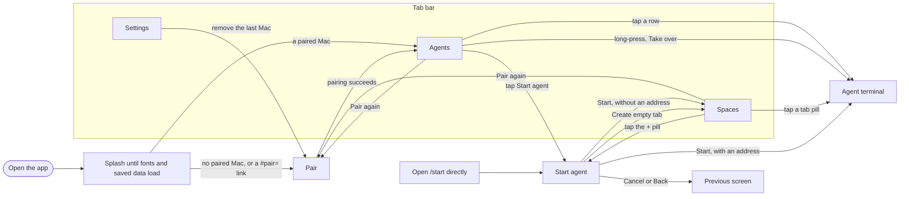

# Feature map

This page lists what a user can see and do in herdr mobile, in the phone and web app and on the Mac's bridge, with the code behind each feature. The tables describe `main`. Work in progress is under [In flight](#in-flight), and work that hasn't started is under [Planned](#planned).

Look a feature up here before you change it. Cite its ID, such as `TERM-5`, in issues, PRs and commit messages.

## Keeping it current

Update this page in the same commit as any change a user can see or do. That covers screens, controls, gestures, messages, role rules and bridge commands.

- Edit the feature's row, or add one. A new feature takes the next free number in its area. IDs never change, and a removed feature's ID is not reused.
- Add a line to the [change log](#change-log), newest first.
- Redraw the [navigation chart](#navigation) when a route, or a way from one screen to another, changes.
- List an open PR that changes a feature under [In flight](#in-flight), and move the change into the tables when it merges.

`bun test` runs [feature-map.test.ts](feature-map.test.ts). It fails when a code path or link here points at nothing, when an app route, screen folder or `herdr-bridge` command has no entry, or when an ID is duplicated or cited without a row.

Code paths start from the repository root, `packages/app/src/` or `packages/bridge/src/`. Tests sit next to their code as `*.test.ts`. UI text in code spans, like `Couldn’t load the app fonts.`, is copied from the code, so a search finds it. `<Mac>` and `<program>` stand for names the app fills in.

## Navigation

Back on the agent terminal returns to the screen that opened it.

## Roles

Pairing gives each device a role. `herdr-bridge pair` makes a control device and `herdr-bridge pair --watch` makes a watch device. The app hides what a watch device can't do. The bridge's gate rejects those calls anyway, using the method lists in `packages/protocol/src/policy.ts`.

| Feature                               | Control | Watch                                                                   |
| ------------------------------------- | ------- | ----------------------------------------------------------------------- |
| Agents, Spaces and terminal output    | Yes     | Yes                                                                     |
| Copy an agent address                 | Yes     | Yes                                                                     |
| Composer and key bar                  | Yes     | No. The composer reads `Watching only` and the key bar is gone          |
| Answer a recognized prompt            | Yes     | No. The question shows without its choices                              |
| Take over, Interrupt, End terminal    | Yes     | No. The More button is gone                                             |
| New space and new tab                 | Yes     | No. The buttons are gone                                                |
| Start an agent or create an empty tab | Yes     | No. Agents and Spaces hide Start, and a direct Start route is read-only |

## App start and tabs

| ID       | User action                                                           | What the app does                                                                                                                                | Code                                                                                                                         |
| -------- | --------------------------------------------------------------------- | ------------------------------------------------------------------------------------------------------------------------------------------------ | ---------------------------------------------------------------------------------------------------------------------------- |
| LAUNCH-1 | Opens the app                                                         | Keeps the splash up until saved settings, paired Macs, seen turns and the five font faces load. Applies the saved theme before the first screen. | `app/_layout.tsx`, `boot.tsx`, `store/lifecycle.ts`, `ui/fonts.ts`, `ui/theme.ts`                                            |
| LAUNCH-2 | Opens the app and the fonts fail to load                              | Shows `Couldn’t load the app fonts.` with Retry.                                                                                                 | `app/_layout.tsx`                                                                                                            |
| LAUNCH-3 | Opens the app with no paired Mac, or opens a `#pair=` link on the web | Shows Pair instead of the tabs.                                                                                                                  | `app/(tabs)/_layout.tsx`, `screens/pair/pair-fragment.ts`                                                                    |
| TABS-1   | Switches tabs                                                         | Shows Agents, Spaces and Settings. The bar computes its height from the icon, the label and the system text size, so labels don't clip.          | `app/(tabs)/_layout.tsx`, `app/(tabs)/index.tsx`, `app/(tabs)/spaces.tsx`, `app/(tabs)/settings.tsx`, `ui/tab-bar-layout.ts` |

## Pairing

Route `/pair`. Code in `screens/pair/`.

| ID     | User action                       | What the app does                                                                                                                                                                                                                                                        | Code                                                                                                                                                                                  |
| ------ | --------------------------------- | ------------------------------------------------------------------------------------------------------------------------------------------------------------------------------------------------------------------------------------------------------------------------ | ------------------------------------------------------------------------------------------------------------------------------------------------------------------------------------- |
| PAIR-1 | Opens Pair                        | Shows three steps: start the bridge, with a copyable `herdr-bridge pair` snippet; scan the code it shows; keep Tailscale on.                                                                                                                                             | `app/pair.tsx`, `screens/pair/PairScreen.tsx`, `screens/pair/PairingSteps.tsx`, `screens/pair/Snippet.tsx`, `screens/pair/snippet-controller.ts`                                      |
| PAIR-2 | Taps `Scan the code`              | Opens the scanner as a sheet on iOS that a downward swipe closes, full screen on Android, and as a centered card on the web. Asks for camera access, then pairs on the first QR code read. With camera access off, it says `You can enter the address and code instead.` | `screens/pair/Scanner.tsx`, `screens/pair/scanner-controller.ts`                                                                                                                      |
| PAIR-3 | Taps `Type the address instead`   | Takes a bridge URL or pairing link and the 8-character code, then pairs on `Pair device`.                                                                                                                                                                                | `screens/pair/ManualEntry.tsx`, `screens/pair/pairing.ts`                                                                                                                             |
| PAIR-4 | Opens a pairing link in a browser | Removes the `#pair=` fragment from the address bar, opens Pair and pairs. Browsers don't send the fragment to the bridge.                                                                                                                                                | `screens/pair/pair-fragment.ts`, `net/pair-link.ts`                                                                                                                                   |
| PAIR-5 | Pairs                             | Sends the code to `/api/pair`, keeps the token in SecureStore on native or browser storage on the web, makes the Mac active and connects. Shows `Paired with <Mac>. Opening agents…` and goes to Agents on its own.                                                      | `screens/pair/PairScreen.tsx`, `screens/pair/pair-controller.ts`, `screens/pair/ConnectionLine.tsx`, `screens/pair/connection-line-state.ts`, `net/bridge-api.ts`, `store/secrets.ts` |
| PAIR-6 | Hits an error                     | Shows the cause in a banner, such as `That pairing code is invalid or has expired. Generate a new code on your Mac.`, with Retry when retrying can help.                                                                                                                 | `screens/pair/pairing.ts`, `screens/pair/pair-controller.ts`                                                                                                                          |

## Connection

The app holds one bridge connection, to the active Mac. Agents and Spaces show its state in a banner. The agent terminal has its own, see `TERM-13`.

| ID     | User action                                | What the app does                                                                                                                                                                      | Code                                                                                             |
| ------ | ------------------------------------------ | -------------------------------------------------------------------------------------------------------------------------------------------------------------------------------------- | ------------------------------------------------------------------------------------------------ |
| CONN-1 | Sends the app to the background, then back | Stops the connection in the background and starts it again in the foreground.                                                                                                          | `store/lifecycle.ts`                                                                             |
| CONN-2 | Picks another Mac                          | Closes the old connection and connects to the new Mac.                                                                                                                                 | `store/lifecycle.ts`, `store/machines.ts`                                                        |
| CONN-3 | Loses the connection                       | Shows `Reconnecting to <Mac>…` and dims cached rows to 60%. Retries after 1, 2, 4 and 8 seconds, then every 15 seconds. 45 seconds without a message also counts as a lost connection. | `net/connection.ts`, `screens/agents/agents-view.ts`, `screens/spaces/connectionPresentation.ts` |
| CONN-4 | Sees the connection stopped                | Shows `Can't reach the bridge. Check that Tailscale is on.` with Retry, which restarts the connection.                                                                                 | `net/connection.ts`, `screens/agents/rowMenu.ts`, `ui/components/Banner.tsx`                     |
| CONN-5 | Uses a device the bridge no longer accepts | Shows `This device is no longer paired with <Mac>.` with `Pair again`, which opens Pair.                                                                                               | `net/connection.ts`, `screens/spaces/PairAgainBanner.tsx`                                        |

## Agents

The first tab, route `/`. Code in `screens/agents/`.

| ID        | User action                                        | What the app does                                                                                                                                                                                                                              | Code                                                                                                   |
| --------- | -------------------------------------------------- | ---------------------------------------------------------------------------------------------------------------------------------------------------------------------------------------------------------------------------------------------- | ------------------------------------------------------------------------------------------------------ |
| AGENTS-1  | Opens Agents                                       | Groups agents as Needs you, Done, Working and Idle, with counts. A row has the program icon, title, space and program, age, a tag for an agent on another machine, and a status mark. A row that needs you adds its question, up to two lines. | `screens/agents/AgentsScreen.tsx`, `screens/agents/AgentRow.tsx`, `model/agents.ts`, `model/status.ts` |
| AGENTS-2  | Taps the sort button                               | Switches between priority groups and groups by space, in herdr-app's space and tab order, and saves the choice. Sorted by space, the subtitle is the program, plus the question when the agent needs you.                                      | `screens/agents/agents-view.ts`, `store/settings.ts`                                                   |
| AGENTS-3  | Taps search and types                              | Filters by title, space or program. × clears the text, and closing search clears the filter.                                                                                                                                                   | `screens/agents/SearchField.tsx`, `screens/agents/agents-view.ts`                                      |
| AGENTS-4  | Taps the machine chip                              | Opens `Paired machines` with each Mac's connection dot and role, and makes the chosen Mac active. A line next to the chip counts agents and spaces.                                                                                            | `screens/agents/MachineChip.tsx`, `store/machines.ts`                                                  |
| AGENTS-5  | Taps a row                                         | Opens the agent terminal.                                                                                                                                                                                                                      | `screens/agents/rowMenu.ts`                                                                            |
| AGENTS-6  | Long-presses a row                                 | Opens a sheet with `Copy address`, plus `Take over` on a control device. Take over opens the terminal and asks to confirm, as in `TERM-9`.                                                                                                     | `screens/agents/rowMenu.ts`, `screens/agents/AgentsScreen.tsx`                                         |
| AGENTS-7  | Has no agents                                      | Shows `No agent status yet. Agents show up here when they report their status. Older versions and agents inside tmux may not.`                                                                                                                 | `ui/components/EmptyState.tsx`                                                                         |
| AGENTS-8  | Keeps Agents open                                  | Refreshes the ages every 30 seconds.                                                                                                                                                                                                           | `screens/agents/agents-view.ts`                                                                        |
| AGENTS-9  | Has a live agent that hasn't reported a status yet | Lists it under Idle with `Waiting for status` when it runs a known agent program or came from a template. It moves to its real group after its first status report.                                                                            | `model/agents.ts`, `screens/agents/AgentRow.tsx`                                                       |
| AGENTS-10 | Taps `Start agent` in the header                   | Opens Start on a control device.                                                                                                                                                                                                               | `screens/agents/AgentsScreen.tsx`, `app/start.tsx`                                                     |

## Agent terminal

Route `/agent/<address>`, opened from Agents or Spaces. Code in `screens/agent/` and `terminal/`. Confirmations use native alerts, or `window.confirm` on the web, through `ui/components/Confirm.ts` and `ui/components/Confirm.web.ts`.

| ID      | User action                                             | What the app does                                                                                                                                                                                                                                                                                                                                                                                                                       | Code                                                                                                                                                                                      |
| ------- | ------------------------------------------------------- | --------------------------------------------------------------------------------------------------------------------------------------------------------------------------------------------------------------------------------------------------------------------------------------------------------------------------------------------------------------------------------------------------------------------------------------- | ----------------------------------------------------------------------------------------------------------------------------------------------------------------------------------------- |
| TERM-1  | Opens an agent                                          | Shows Back, the title, the space and Mac, and a More button on a control device. Back detaches the stream.                                                                                                                                                                                                                                                                                                                              | `app/agent/[address].tsx`, `screens/agent/AgentScreen.tsx`, `screens/agent/screen-controller.ts`                                                                                          |
| TERM-2  | Reads the status strip                                  | Shows the state and age, or a `Needs you` pill, on the left. Shows `Watching`, `In control`, `Connecting…` or `Disconnected` on the right.                                                                                                                                                                                                                                                                                              | `screens/agent/StatusStrip.tsx`                                                                                                                                                           |
| TERM-3  | Watches                                                 | Attaches in observe mode at the Mac terminal's size, so the Mac terminal keeps its size.                                                                                                                                                                                                                                                                                                                                                | `screens/agent/useAttachment.ts`, `screens/agent/attachment.ts`                                                                                                                           |
| TERM-4  | Reads the terminal                                      | Shows a header with the program icon, the folder and cols × rows, above a text grid that scrolls both ways. Opens at, and follows, the last row with text or the cursor. Scrolling away pauses following, and scrolling back to within one row resumes it. On the web, blank rows and leading spaces keep their place.                                                                                                                  | `terminal/TerminalPane.tsx`, `terminal/TerminalGrid.tsx`, `terminal/follow-state.ts`, `terminal/grid-layout.ts`, `terminal/scroll-anchor.ts`, `terminal/model.ts`, `terminal/snapshot.ts` |
| TERM-5  | Pinches or double-taps                                  | Pinching goes up to 16 pt and down to 8 pt, or further to an overview where every column fits the pane. Double-tap switches between that overview and 10.6 pt. When every column already fits at 10.6 pt, double-tap returns to 10.6 pt.                                                                                                                                                                                                | `terminal/zoom.ts`, `terminal/TerminalGrid.tsx`                                                                                                                                           |
| TERM-6  | Taps a key bar key                                      | Sends esc, ⌃C, tab, an arrow key or ⏎ through `terminal.keys`, with a light haptic.                                                                                                                                                                                                                                                                                                                                                     | `screens/agent/KeyBar.tsx`, `screens/agent/Key.tsx`, `screens/agent/actions.ts`, `screens/agent/useTerminalInput.ts`, `screens/agent/key-queue.ts`                                        |
| TERM-7  | Types a message and sends it                            | Sends the text with `terminal.send`, adding `force` when the agent needs you. Shows `Sent · waiting for <program>` until the agent reports working or 20 seconds pass. Errors show above the field.                                                                                                                                                                                                                                     | `screens/agent/Composer.tsx`, `screens/agent/composer-controller.ts`, `screens/agent/useSent.ts`, `screens/agent/sent-controller.ts`, `model/sent.ts`                                     |
| TERM-8  | Answers a Claude Code or Codex question                 | Shows a card with the question, any detail and one button per choice in the menu on screen. The question comes from the agent's own status message, else from the dialog on screen, else a neutral line such as `<program> is asking for permission`. A choice sends its keys. A watch device sees the question without buttons. A question the app doesn't recognize leaves the composer, with `Answer <program>…` as its placeholder. | `screens/agent/PromptCard.tsx`, `screens/agent/prompt-answer.ts`, `model/prompt.ts`, `model/prompt/screen.ts`, `model/prompt/claude.ts`, `model/prompt/codex.ts`                          |
| TERM-9  | Taps More, then `Take over`                             | Asks `Take over terminal?`, then reattaches with input and resizes the Mac terminal to the grid that fits the pane at the current zoom, or at 8 pt when zoomed out further.                                                                                                                                                                                                                                                             | `screens/agent/MoreMenu.tsx`, `screens/agent/actions.ts`, `screens/agent/agent-effects.ts`                                                                                                |
| TERM-10 | Taps More, then `Interrupt`                             | Asks `Interrupt agent?`, then sends Ctrl-C.                                                                                                                                                                                                                                                                                                                                                                                             | `screens/agent/MoreMenu.tsx`, `screens/agent/actions.ts`                                                                                                                                  |
| TERM-11 | Taps More, then `Copy address`                          | Copies the terminal's address.                                                                                                                                                                                                                                                                                                                                                                                                          | `screens/agent/MoreMenu.tsx`, `screens/agent/actions.ts`                                                                                                                                  |
| TERM-12 | Taps More, then `End terminal`                          | Asks `End terminal?`, then calls `terminal.kill`.                                                                                                                                                                                                                                                                                                                                                                                       | `screens/agent/MoreMenu.tsx`, `screens/agent/actions.ts`, `screens/agent/agent-effects.ts`                                                                                                |
| TERM-13 | Loses the connection or the stream, or the program ends | Shows a banner, dims the pane and turns input off. A program that ended shows `The program exited with code <N>.`, `The program was stopped by <signal>.` or `The program has ended.` A lost stream shows `The terminal stream is unavailable.`                                                                                                                                                                                         | `screens/agent/screen-controller.ts`                                                                                                                                                      |
| TERM-14 | Opens an agent that is done                             | Marks its current turn as seen, so it moves from Done to Idle in Agents.                                                                                                                                                                                                                                                                                                                                                                | `screens/agent/screen-controller.ts`, `store/seen.ts`, `model/seen.ts`                                                                                                                    |

## Spaces

The second tab, route `/spaces`. Code in `screens/spaces/`.

| ID       | User action                          | What the app does                                                                                                                                                    | Code                                                                                                                                    |
| -------- | ------------------------------------ | -------------------------------------------------------------------------------------------------------------------------------------------------------------------- | --------------------------------------------------------------------------------------------------------------------------------------- |
| SPACES-1 | Opens Spaces                         | Shows one group per machine, tagged `this Mac` or `ssh`, with spaces in herdr-app's order. Without herdr-app's layout document it names spaces from terminal labels. | `screens/spaces/SpacesScreen.tsx`, `screens/spaces/useSpaces.ts`, `model/spaces.ts`, `screens/spaces/viewState.ts`                      |
| SPACES-2 | Taps a space                         | Expands it to show its tabs, or collapses it.                                                                                                                        | `screens/spaces/SpaceRow.tsx`                                                                                                           |
| SPACES-3 | Taps a tab pill                      | Opens the tab's first terminal. A pill shows the program icon, the tab name, and a dot when the tab needs you or is done.                                            | `screens/spaces/TabPill.tsx`, `screens/spaces/viewState.ts`                                                                             |
| SPACES-4 | Taps + in the header                 | Asks the bridge to run herdr-app's `space.new` on the Mac. Shows `Herdr isn't running on your Mac` when herdr-app is closed. Control devices only.                   | `screens/spaces/useSpaces.ts`, `screens/spaces/newItems.ts`, `net/bridge-api.ts`, `server/app-cli.ts`                                   |
| SPACES-5 | Taps the + pill in an expanded space | Opens Start with that space selected. `Empty tab` there runs `tab.new` for the resolved space. Control devices only.                                                 | `screens/spaces/SpaceRow.tsx`, `screens/spaces/SpacesScreen.tsx`, `app/start.tsx`, `model/spaceTarget.ts`, `screens/spaces/newItems.ts` |
| SPACES-6 | Has no spaces                        | Shows `No spaces yet. Spaces you make in Herdr show up here.`                                                                                                        | `ui/components/EmptyState.tsx`                                                                                                          |

## Start agent

Route `/start`. Code in `screens/start/`.

| ID      | User action                                     | What the app does                                                                                                                                                                                                                                                                                  | Code                                                                                                                                                                |
| ------- | ----------------------------------------------- | -------------------------------------------------------------------------------------------------------------------------------------------------------------------------------------------------------------------------------------------------------------------------------------------------- | ------------------------------------------------------------------------------------------------------------------------------------------------------------------- |
| START-1 | Opens Start                                     | Opens from `Start agent` in the Agents header or the `+` pill in an expanded space. A space launch selects that space. The route can also open directly.                                                                                                                                           | `app/start.tsx`, `screens/agents/AgentsScreen.tsx`, `screens/spaces/SpacesScreen.tsx`, `screens/start/StartScreen.tsx`                                              |
| START-2 | Picks a run or taps `Refresh`                   | Lists the programs and templates from the bridge catalog. If the catalog can't load, offers Claude Code and Codex. Refresh reloads the catalog after a load error or a `run_not_allowed` refusal.                                                                                                  | `screens/start/StartScreen.tsx`, `screens/start/RunList.tsx`, `screens/start/start-controller.ts`, `net/bridge-api.ts`                                              |
| START-3 | Chooses a space and folder                      | Offers existing spaces and `New space`. Suggests the space folder, its terminal folders and the last five folders used on this phone. `Other…` accepts an absolute path or a `~/` path; the bridge checks that it is allowed and exists.                                                           | `screens/start/WherePicker.tsx`, `screens/start/FolderPicker.tsx`, `model/startAgent.ts`, `store/settings.ts`, `net/bridge-api.ts`                                  |
| START-4 | Enters a first message                          | When Herdr is closed, a built-in program shows `<program> gets a first message only while Herdr is open on your Mac.` Typing stays enabled. A refusal shows `First messages for <program> need Herdr open on your Mac. Open Herdr, or leave the message empty.` with `Refresh`, keeping the draft. | `screens/start/StartScreen.tsx`, `screens/start/start-controller.ts`, `net/bridge-api.ts`                                                                           |
| START-5 | Reviews the summary and taps `Start <program>`  | Shows the selected run, folder, space and tab before starting. An address opens the agent terminal; a reply without an address opens Spaces. Shows `Started in Herdr.` or `Started in herdr-core. Herdr shows it when it opens.` after success.                                                    | `screens/start/StartScreen.tsx`, `screens/start/start-controller.ts`, `app/agent/[address].tsx`, `screens/agent/AgentScreen.tsx`, `screens/spaces/SpacesScreen.tsx` |
| START-6 | Selects `Empty tab` and taps `Create empty tab` | Creates a blank tab in the selected existing space through `tab.new`, without starting an agent. Then opens Spaces.                                                                                                                                                                                | `screens/start/StartScreen.tsx`, `screens/start/start-controller.ts`, `model/spaceTarget.ts`, `screens/spaces/newItems.ts`                                          |
| START-7 | Opens Start on a watch device or while offline  | Watch devices see `This device is read-only. Starting agents is available on control devices.` A control device without a bridge connection sees an offline banner and a disabled Start action. Neither can start an agent or create an empty tab.                                                 | `screens/start/StartScreen.tsx`, `screens/start/start-access.ts`, `screens/start/start-controller.ts`                                                               |

## Settings

The third tab, route `/settings`. Code in `screens/settings/`.

| ID         | User action                       | What the app does                                                                                                                                                                         | Code                                                                                                |
| ---------- | --------------------------------- | ----------------------------------------------------------------------------------------------------------------------------------------------------------------------------------------- | --------------------------------------------------------------------------------------------------- |
| SETTINGS-1 | Picks System, Graphite or Paper   | Applies the theme at once and saves it. System follows the device's appearance.                                                                                                           | `screens/settings/ThemeRow.tsx`, `store/settings.ts`, `ui/theme.ts`                                 |
| SETTINGS-2 | Turns Needs you or Done on or off | Saves the choice. Nothing sends push notifications yet, see [Planned](#planned).                                                                                                          | `screens/settings/NotificationsRows.tsx`, `store/settings.ts`                                       |
| SETTINGS-3 | Taps Remove on a paired Mac       | Asks to confirm, then revokes this device through the bridge if it can. Deletes the token and the Mac from this device either way, and says so when the bridge didn't confirm the revoke. | `screens/settings/MachinesSection.tsx`, `screens/settings/settings-actions.ts`, `net/bridge-api.ts` |
| SETTINGS-4 | Reads About                       | Shows the app version, the bridge protocol version, and a note that the web app keeps its token in browser storage.                                                                       | `screens/settings/AboutSection.tsx`                                                                 |

## Bridge on the Mac

The user runs these on the Mac. From a checkout, `bun run bridge <command>` runs the same CLI. Setup is in [bridge.md](bridge.md).

| ID       | User action                                                                 | What the bridge does                                                                                                                                                                                                                                                                                                                                                                                                                                          | Code                                                                       |
| -------- | --------------------------------------------------------------------------- | ------------------------------------------------------------------------------------------------------------------------------------------------------------------------------------------------------------------------------------------------------------------------------------------------------------------------------------------------------------------------------------------------------------------------------------------------------------- | -------------------------------------------------------------------------- |
| BRIDGE-1 | Runs `herdr-bridge serve --owner <login>`                                   | Listens on 127.0.0.1, port 8787 by default, behind Tailscale Serve. Serves the API, the `/ws` WebSocket and, with `--web`, the web app.                                                                                                                                                                                                                                                                                                                       | `server/cli.ts`, `server/serve.ts`, `server/config.ts`, `server/routes.ts` |
| BRIDGE-2 | Runs `herdr-bridge pair`                                                    | Prints a QR code and a link. The one-time code lasts ten minutes and allows five tries. `--watch` pairs a watch device and `--name` names it.                                                                                                                                                                                                                                                                                                                 | `server/cli.ts`, `server/pairing.ts`, `server/admin-routes.ts`             |
| BRIDGE-3 | Runs `herdr-bridge devices` or `herdr-bridge devices revoke <id>`           | Lists paired devices, or revokes one.                                                                                                                                                                                                                                                                                                                                                                                                                         | `server/cli.ts`, `server/devices.ts`                                       |
| BRIDGE-4 | Runs `herdr-bridge status`                                                  | Prints JSON with the machine, public URL, listen address, session count and device count.                                                                                                                                                                                                                                                                                                                                                                     | `server/cli.ts`, `server/admin-routes.ts`                                  |
| BRIDGE-5 | Opens the bridge's HTTPS address in a browser                               | Serves the web app. Paths that match no file get `index.html`, so app routes load directly.                                                                                                                                                                                                                                                                                                                                                                   | `server/static.ts`                                                         |
| BRIDGE-6 | Connects from any device                                                    | Lets in only the owner's Tailscale login. Checks each JSON-RPC call against the device's role.                                                                                                                                                                                                                                                                                                                                                                | `server/identity.ts`, `server/gate.ts`, `packages/protocol/src/policy.ts`  |
| BRIDGE-7 | Starts an agent from a control device                                       | `GET /api/agents/catalog` lists allowed runs and roots; `POST /api/agents/start` starts them under home or a `--run-root`, in an absolute or `~/` folder, using Herdr if open or herdr-core otherwise. Built-in first messages need Herdr or return 422. Roots list by real path when available and configured spelling otherwise. Missing or stalled root calls are capped at five seconds, so starts under other roots proceed. Home is always shown first. | `server/agents-routes.ts`, `server/start-agent.ts`, `server/roots.ts`      |
| BRIDGE-8 | Runs `herdr-bridge serve` with `--run-program <name>` or `--run-root <dir>` | Adds a built-in program to the catalog, or allows starts from an additional folder root. `claude` and `codex` are allowed by default, and the home folder is always allowed. Root resolution is lazy; an unavailable root never delays bridge startup.                                                                                                                                                                                                        | `server/cli.ts`, `server/config.ts`, `server/roots.ts`                     |
| BRIDGE-9 | Starts an agent                                                             | Prints an `Agent started` log line with the caller, run, canonical folder, placement and resulting space and tab.                                                                                                                                                                                                                                                                                                                                             | `server/start-agent.ts`                                                    |

## In flight

Nothing is in flight.

## Planned

| Feature                                                                                                                 | Tracking                                                                    | Rows           |
| ----------------------------------------------------------------------------------------------------------------------- | --------------------------------------------------------------------------- | -------------- |
| Push notifications for Needs you and Done                                                                               | #17, waiting for push credentials                                           | SETTINGS-2     |
| Pair another Mac from the app, such as a row in Settings                                                                | Needs a planning round                                                      | PAIR-5         |
| Reach the bridge without Tailscale on the phone, through an end-to-end encrypted relay on the user's Cloudflare account | Proposed in [research.md](research.md#relay-on-cloudflare), not planned yet | CONN-3, PAIR-5 |

## Known gaps

These are on `main` today.

- On the web, scrolling to the very top of a tall terminal that is still printing gets pulled back down. #36 merged with this review finding open. `TERM-4`.
- An agent that never sends a status report stays under Idle with `Waiting for status`. It never shows Needs you, Done or a prompt card. `AGENTS-9`, `TERM-8`.
- The app has no way to pair a second Mac. #47 removed `Pair another Mac`, so Pair opens only on first launch, from `Pair again`, or from a `#pair=` link. `PAIR-5`.
- The Spaces header's `New space` action remains available while the Mac is offline or unauthorized. The expanded-space `+` pill still opens Start for a control device, but Start and `Empty tab` are disabled until the bridge reconnects. `SPACES-4`, `SPACES-5`, `START-7`.
- When Start opens from a space's `+` pill, the preselection resolves after the first catalog request. If Herdr's layout arrives while that request is pending and lists spaces in a different order, Start selects the first space instead and drops `Empty tab`. The summary still shows the chosen space before Start, so nothing starts unseen. #51. `START-1`, `START-3`, `START-6`, `SPACES-5`.
- Prompt recognition knows Claude Code and Codex only. Other agents get the composer. `TERM-8`.
- The Pair snippet copies `herdr-bridge pair`, which works only if the bridge's bin is on `PATH`. From a checkout the command is `bun run bridge pair`. `PAIR-1`.
- Nobody has run the app on Android yet.

## Change log

Newest first. One line per user-visible change, with the PR or commit and the rows it touched.

- 2026-11-04, #50. Agents and Spaces open Start, which supports agent starts and `Empty tab` with role and connection limits. `AGENTS-10`, `SPACES-5`, `START-1` to `START-7`, Roles, Navigation.
- 2026-11-04, #49. Control devices can start allowed programs and templates in Herdr or herdr-core, with folder limits and a first-message check. `--run-program` and `--run-root` configure choices; roots are resolved lazily, listed by real path when available, and kept in their configured spelling when unavailable without delaying startup, the catalog or a start under another allowed root. Successful starts print `Agent started`. `BRIDGE-7`, `BRIDGE-8`, `BRIDGE-9`.
- 2026-11-03. Started this map. It describes `main` at 2fc008a.
- 2026-11-03, #36. The terminal opens at and follows the last row with text or the cursor, and the web keeps blank rows and leading spaces. Pinching out reaches an overview where every column fits, and double-tap switches between it and 10.6 pt. A finished terminal says how it ended, and tab labels no longer clip on the web. `TERM-4`, `TERM-5`, `TERM-9`, `TERM-13`, `TABS-1`.
- 2026-11-03, #47. Pairing opens Agents on its own, and the scanner is a sheet on iOS and a card on the web. `Open agents` and `Pair another Mac` are gone. `PAIR-2`, `PAIR-5`.
- 2026-11-03, #45. Agents lists live agents that haven't reported, with `Waiting for status`. `AGENTS-9`.
- 2026-11-03, #37. Prompt cards take the question from the agent's status message first. Fixes #9. `TERM-8`.
- 2026-11-03, #34. The native app no longer crashes at launch, where `@xterm/headless` read `navigator.userAgent`.
- 2026-11-02, #18 to #31. First version, with pairing, Agents, the agent terminal, Spaces, Settings and the bridge.
